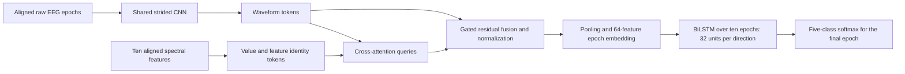

# Sleep-EDF SSL, cross-attention and BiLSTM

The maintained model supports `temporal_head: "bilstm"`. The initial recipe uses
32 LSTM units per direction and concatenates the two outputs into 64 features.
That matches the output width of the earlier 64-unit GRU. This follows Keras'
[Bidirectional](https://keras.io/api/layers/recurrent_layers/bidirectional/) and
[LSTM](https://keras.io/api/layers/recurrent_layers/lstm/) APIs. Equal output
width does not imply equal model capacity; record actual parameter counts.

## Representation and temporal model



Each epoch is 30 seconds at 100 Hz (3,000 samples). The CNN produces 30 tokens
of dimension 64 per epoch. Four attention heads attend to ten spectral keys,
one per named feature; the learned gate scales the spectral context before a
residual addition and layer normalization. The BiLSTM processes a sequence of
ten epoch embeddings. Its two directions see only the supplied window, which
ends at the target epoch. No future target epochs are added. Filtering remains
offline and zero phase, so this is not an online/causal deployment claim.

The spectral reference uses one BiLSTM with the same 32 units per direction
directly on the ten-feature sequence. It is newly trained for this family.
`spectral_units` belongs to the legacy stacked-LSTM reference; the BiLSTM
reference uses `temporal_units`, like the other variants.

## What SSL learns

Source-only contrastive training learns the waveform CNN from quality-valid
Sleep-EDF training epochs. Two independently augmented views use the existing
gain/noise/short-mask policy and NT-Xent objective. Stage labels and engineered
features are not SSL inputs. The project then transfers waveform encoder
weights into a newly initialized classifier. Cross-attention, spectral tokens
and the BiLSTM learn from stage labels during fine-tuning, with the encoder
also trainable. This is waveform SSL followed by supervised dual-view fusion.

The same label-independent waveform normalization pool is used for scratch and
SSL comparisons. Spectral scaling fits only unique eligible epochs belonging
to the selected labeled training budget. Validation and held-out cohorts do
not fit normalization. The fixed participant split and window eligibility
rules remain unchanged.

## Seven conditions

| Condition | Epoch representation | Waveform initialization | Temporal model |
|---|---|---|---|
| M0 | Spectral features | Not applicable | BiLSTM |
| M1 | Waveform CNN | Scratch | BiLSTM |
| M2 | Raw/spectral concatenation | Scratch | BiLSTM |
| M3 | Gated cross-attention | Scratch | BiLSTM |
| M4 | Waveform CNN | SSL | BiLSTM |
| M5 | Raw/spectral concatenation | SSL | BiLSTM |
| M6 | Gated cross-attention | SSL | BiLSTM |

M4-M1, M5-M2 and M6-M3 assess SSL within an architecture; M3-M2 and M6-M5
compare fusion approaches. M0 is a spectral control with a different input
representation. Attention maps alone do not establish physiological mechanisms.
Do not use high contrastive retrieval accuracy as sleep-stage accuracy.

The first full source matrix retains 18/70 labeled participants, the fixed
70-person unlabeled pool, 15 validation participants and optimization seed 42.
It is a single-seed experiment; publication conclusions require review of
learning curves, paired participant-level uncertainty and seed variability.
No real ISRUC or new source-test scoring is scheduled by these configurations.

## Configurations and execution

Run from the checkout root through the native CPU launcher:

```powershell
powershell -NoProfile -ExecutionPolicy Bypass -File scripts/research_cpu.ps1 -m src.compute.preflight --allow-cpu --temporal-head bilstm --temporal-units 32 --report runs/my_bilstm_preflight.json

powershell -NoProfile -ExecutionPolicy Bypass -File scripts/research_cpu.ps1 -m src.experiments.run plan --config configs/sleepedf/experiments/experiment_bilstm_pilot.json --study-dir runs/my_bilstm_pilot
powershell -NoProfile -ExecutionPolicy Bypass -File scripts/research_cpu.ps1 -m src.experiments.run execute --study-dir runs/my_bilstm_pilot --live
```

The pilot uses the full architecture and all seven conditions, but only two
training participants, one validation participant, one epoch and two batches
per stage. Both label budgets have identical validation target IDs. It checks
integration, transfer, checkpoint serialization and source-only selection; its
metrics cannot establish convergence or an SSL/attention benefit.

`experiment_bilstm_source_benchmark.json` then checks all 70/15 source
participants with M3/M6, two epochs and capped batches. The uncapped recipe is
`experiment_bilstm_matrix.json`: ten SSL epochs, up to 30 supervised epochs,
patience five, batch four and SSL batch 32. Best supervised checkpoints maximize
source-validation macro-F1. Always use fresh study directories and freeze source
code/packages before execution. The kernel check is not a data-loader benchmark.

For the full-source benchmark and a disposable training profile:

```powershell
powershell -NoProfile -ExecutionPolicy Bypass -File scripts/research_cpu.ps1 -m src.experiments.run plan --config configs/sleepedf/experiments/experiment_bilstm_source_benchmark.json --study-dir runs/my_bilstm_source_benchmark
powershell -NoProfile -ExecutionPolicy Bypass -File scripts/research_cpu.ps1 -m src.experiments.run execute --study-dir runs/my_bilstm_source_benchmark --live
powershell -NoProfile -ExecutionPolicy Bypass -File scripts/research_cpu.ps1 -m src.evaluation.profile --bundle runs/my_bilstm_source_benchmark/jobs/M3_draw42_n70_seed42/attempt_0001/artifacts --output-dir runs/my_bilstm_training_profile --recordings SC4001 --mode training --batch-size 4 --warmup-steps 5 --measured-steps 50
```

Inspect each command's exit code and outputs before continuing. The profiler
discards its optimizer updates and verifies that saved artifacts are unchanged.
Training execution now belongs to the user. The prior background controller is
stopped; the [terminal handoff](operations/TRAINING_RUNBOOK.md#current-handoff-user-run-terminal-training)
provides the already-planned full-study command. `--live` retains logs while
showing periodic SSL/supervised batch progress. The assistant does not execute
these optimizer-based commands under the current ownership preference.

Single-model recipes are `configs/sleepedf/models/supervised_*_bilstm.json`.
The existing `configs/sleepedf/pretraining/pretrain_raw.json` describes the
architecture-compatible raw SSL encoder; a temporal head is not used in SSL.
For a trained compatible encoder bundle, supervised training supports
`--pretrained <completed_ssl_bundle_directory>`. The study runner wires this
dependency and shared normalization automatically for M4-M6.

## Compatibility and historical runs

Missing `temporal_head` fields resolve to `legacy`: earlier waveform models
retain their GRU and the old spectral reference retains its stacked LSTMs.
Existing configurations and historical bundles are not rewritten. For BiLSTM
inference, bundle loading also checks the declared recurrent architecture and
units. Linear probes contain no temporal model and retain their separate mode.

The stopped earlier three-epoch SSL checkpoint remains historical evidence.
It has no completed encoder-transfer bundle, and strict resume/code guards are
not bypassed after this implementation change. The new study starts fresh.
The earlier GRU matrix must not be restarted automatically. ISRUC remains
deferred and unopened while this model family is developed and selected.
Historical source-test inspection remains part of the project's provenance;
disclose it when reporting any later source-test results.
