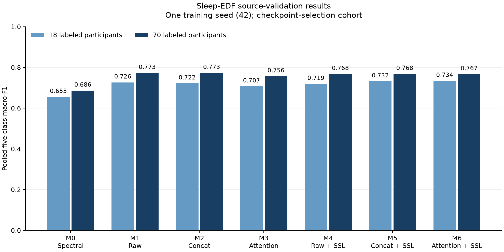

# Completed first BiLSTM source study — 12 November 2026

The user completed `runs/bilstm_terminal_2026-11-02` in their own terminal.
All 18 jobs are complete and verified: three preparation jobs, ten fixed SSL
epochs, and fourteen supervised classifiers (M0–M6 at 18/70 labeled participants,
training seed 42 and label-draw seed 42). No worker or scheduler remains active.
This is the first completed uncapped one-seed source study, not the capped pilot.

The classifiers completed 132 epochs in total. Recorded completed classifier
and SSL durations sum to approximately 118.0 hours, excluding preparation and
the two interrupted first attempts. That sum is not a hardware benchmark.
The interrupted M5/budget-18 and M4/budget-70 attempts remain preserved; their
successful second attempts are the ones included in all results.

## Verification

`status.json` confirms all completed job inventories, code/package agreement,
dataset scope and absence of an active scheduler. `verification.json` records
additional checks by `verify_completion.py`:

- Fourteen model archives pass ZIP CRC checks and contain finite stored tensors.
- Histories have consecutive epoch indices and finite values; best epochs match
  the declared maximum pooled source-validation macro-F1 policy.
- All fourteen exported prediction sets contain the same 65,133 validation
  targets from fifteen validation participants; probabilities and stage labels
  validate and recomputed metrics match saved summaries.
- Each budget shares one identical normalizer across its seven conditions.
  All conditions retain the same quality-only waveform normalization pool.
- All six SSL fine-tunes record the same verified encoder and pretraining bundle.
- All ten historical baseline artifact hashes still match.

No TensorFlow import, optimizer step, new model inference, source-test scoring
or ISRUC scoring was performed in this completion review. Source, packages,
study files, data and historical attempts were not modified. Existing saved
validation predictions were analyzed with the implemented uncertainty module.

## Pooled source-validation results

These are the scores used for checkpoint selection, not held-out test scores.
All conditions use BiLSTM temporal heads.

| Condition | Representation / initialization | 18 participants | 70 participants |
|---|---|---:|---:|
| M0 | Spectral features | 0.655117 | 0.686254 |
| M1 | Raw waveform / scratch | 0.726231 | 0.773059 |
| M2 | Concatenation / scratch | 0.721672 | 0.773037 |
| M3 | Gated cross-attention / scratch | 0.706983 | 0.756461 |
| M4 | Raw waveform / SSL | 0.719047 | 0.767726 |
| M5 | Concatenation / SSL | 0.731709 | 0.768212 |
| M6 | Gated cross-attention / SSL | 0.733935 | 0.766701 |

M6 has the highest pooled macro-F1 at the smaller budget; raw and concatenation
scratch controls are effectively tied at the larger budget. SSL improves the
gated model relative to its scratch version at both budgets, but raw-waveform
SSL has lower pooled scores than raw scratch at both budgets. Concatenation SSL
improves the smaller-budget pooled score and decreases the larger-budget score.
The combined model is not the overall winner at the full label budget.

## Participant-level analysis

`draw42_n18_analysis/` and `draw42_n70_analysis/` contain all participant-level,
per-stage and probability-calibration results from existing exports. Analysis
uses 2,000 paired participant-cluster bootstrap replicates, 95% percentile
intervals, analysis seed 42 and fifteen equal-width calibration bins.
Participant-mean macro-F1 averages each person's fixed-five-class macro-F1,
which is distinct from pooled macro-F1. The selection policy was not changed.

| Budget | Comparison | Pooled delta | Participant-mean delta | Participant-mean 95% interval |
|---|---|---:|---:|---|
| 18 | Raw SSL minus scratch (M4–M1) | -0.00718 | +0.00039 | [-0.02348, +0.02424] |
| 18 | Concat SSL minus scratch (M5–M2) | +0.01004 | +0.02672 | [+0.00584, +0.04616] |
| 18 | Attention SSL minus scratch (M6–M3) | +0.02695 | +0.02682 | [+0.00833, +0.04600] |
| 18 | Attention minus concat, scratch (M3–M2) | -0.01469 | -0.00554 | [-0.02287, +0.01187] |
| 18 | Attention minus concat, SSL (M6–M5) | +0.00223 | -0.00544 | [-0.02499, +0.01478] |
| 70 | Raw SSL minus scratch (M4–M1) | -0.00533 | +0.00081 | [-0.01130, +0.01216] |
| 70 | Concat SSL minus scratch (M5–M2) | -0.00482 | -0.00630 | [-0.01886, +0.00900] |
| 70 | Attention SSL minus scratch (M6–M3) | +0.01024 | +0.00780 | [-0.01401, +0.02878] |
| 70 | Attention minus concat, scratch (M3–M2) | -0.01658 | -0.01988 | [-0.03723, -0.00180] |
| 70 | Attention minus concat, SSL (M6–M5) | -0.00151 | -0.00577 | [-0.03444, +0.01746] |

The smaller-budget concat and attention SSL contrasts have positive exploratory
participant intervals. This is an initial signal worth replication, not a
confirmatory conclusion. The intervals condition on the single trained seed
and label draw, use only fifteen validation participants, and apply neither
multiple-comparison nor checkpoint-selection correction. Because validation
selected checkpoints, it is not independent confirmation. Ranking can differ
between pooled and equal-participant endpoints: for example M6 versus M5 at
budget 18 changes sign. Do not silently substitute one endpoint for the other.

## Next research decision

Review learning curves, class-specific errors and calibration with these
matched controls before changing training or claiming a mechanism. Preserve
the completed study as immutable evidence. Additional seeds, any SSL or fusion
changes, and their model-selection policy must be frozen in fresh studies;
training remains user-owned. Paired participant intervals do not replace
optimization-seed replication.

Before any new held-out scoring, freeze the model family, primary endpoint,
comparisons and complete evaluation policy. The historical source-test baseline
was already inspected in earlier work and must be disclosed; this review has
not opened new source-test predictions. ISRUC predictive scoring remains
unopened and cross-dataset work remains deferred. These results do not isolate
a BiLSTM-versus-LSTM effect, because that matched comparison is absent from this
matrix. Attention weights alone do not demonstrate physiological causation.

## Artifacts and reproduction

- `validation_results.csv`: pooled and participant-mean scores, participant
  intervals, Brier score, ECE and epoch counts for all fourteen models.
- `validation_contrasts.csv`: both endpoint differences and participant intervals.
- `per_stage_results.csv`: class support, precision, recall and F1.
- Each budget's registry/analysis folder: bundle provenance, full summaries,
  individual participant metrics and calibration-bin statistics.
- `validation_macro_f1.png` / `.svg`: standalone pooled-score figure, one seed.

`verify_completion.py` regenerates analysis in a fresh report location; it refuses
to overwrite existing analysis directories and verification evidence. The script
uses the project root inferred from its report directory. `plot_results.py`
redraws the figure from `validation_results.csv`. Neither script trains models.
