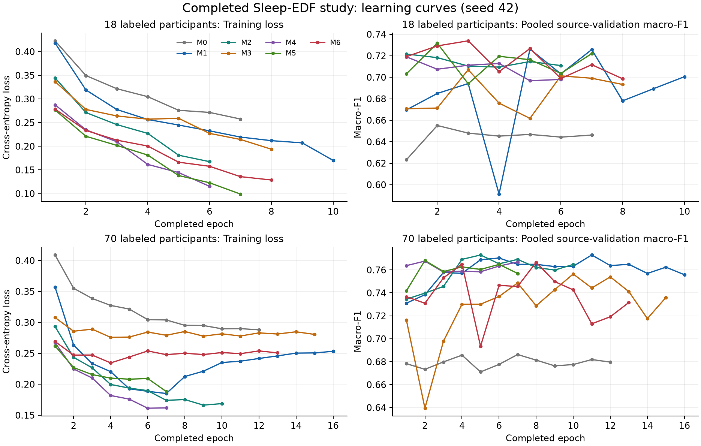

# Learning-curve review and next-step decision — 12 November 2026

All 18 completed job inventories were rechecked through the read-only status
tool; no scheduler was running. `analyze_learning.py` verifies each supervised
job seal and reads its existing training history. It saves
`learning_summary.csv` and standalone `learning_curves.png`/`.svg` figures.
No TensorFlow import, model fitting, optimizer update, held-out prediction or
study/source/package modification occurred.

## Observations from this seed

- Raw SSL selected epochs 1 and 2 at budgets 18 and 70. At full labels, concat
  SSL selected epoch 2, while its scratch counterpart selected epoch 5 and raw
  scratch selected epoch 11. These are observed schedules, not evidence that
  more SSL or longer supervised training would improve results.
- Gated SSL at budget 70 selected epoch 8; its last validation macro-F1 was
  0.73163 versus its selected 0.76670. Best-checkpoint selection matters.
- Validation scores fluctuate while training loss generally falls. The cause
  cannot be identified from these curves alone: fitting dynamics, participant
  variability and the fixed optimization recipe all require controlled tests.
- N1 is the weakest class in each of the fourteen models by pooled class F1
  (see the completed analysis's per-stage table). At full labels, attention SSL
  reaches N1 F1 0.47593 versus 0.45222 for raw scratch, but has lower N3/REM F1
  and a lower overall macro-F1. The class trade-off warrants inspection rather
  than treating its N1 gain as overall superiority.
- At budget 18, concat SSL improves REM F1 from 0.63516 to 0.72995 while N3 F1
  decreases from 0.75859 to 0.70269. Attention SSL improves N3/REM over attention
  scratch. Component effects are not uniform across sleep stages.

These observations use source-validation outputs already used to select
checkpoints. They generate development hypotheses and do not establish causal
mechanisms, generalization, seed robustness or statistically confirmed gains.

The concrete staged plan is [docs/NEXT_STEPS.md](../../docs/NEXT_STEPS.md).
The first engineering priorities are epoch-boundary supervised recovery and
faster equivalent full-cohort validation. Two outages and the validation-loop
cost justify those before another long campaign. Method changes, new seeds,
hardware benchmarks and evaluation policies need separate gates/fresh freezes.
No new training study was created or launched in this review.
